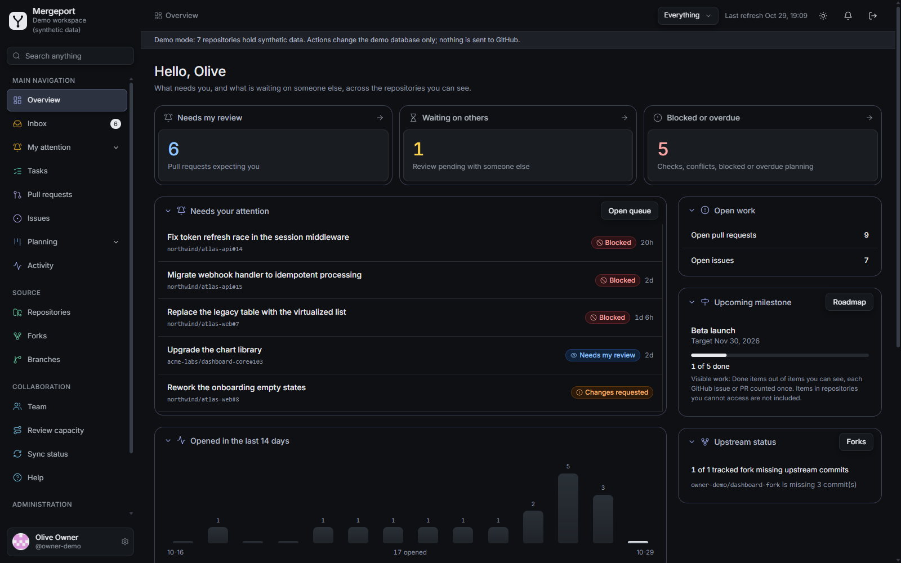
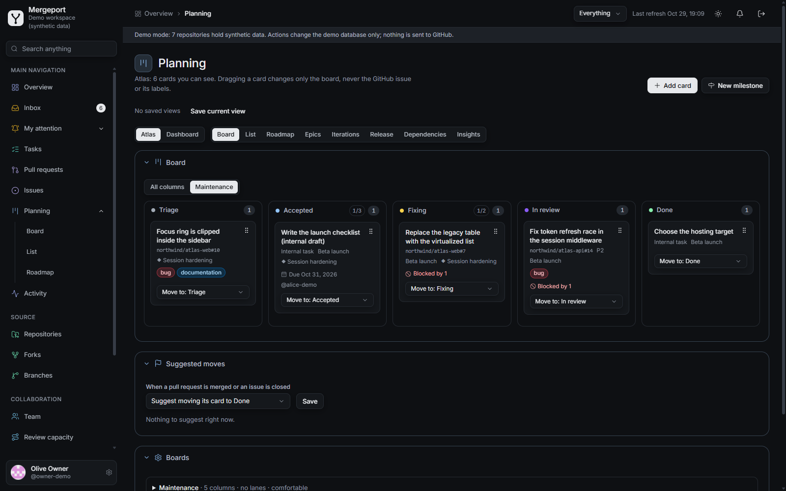
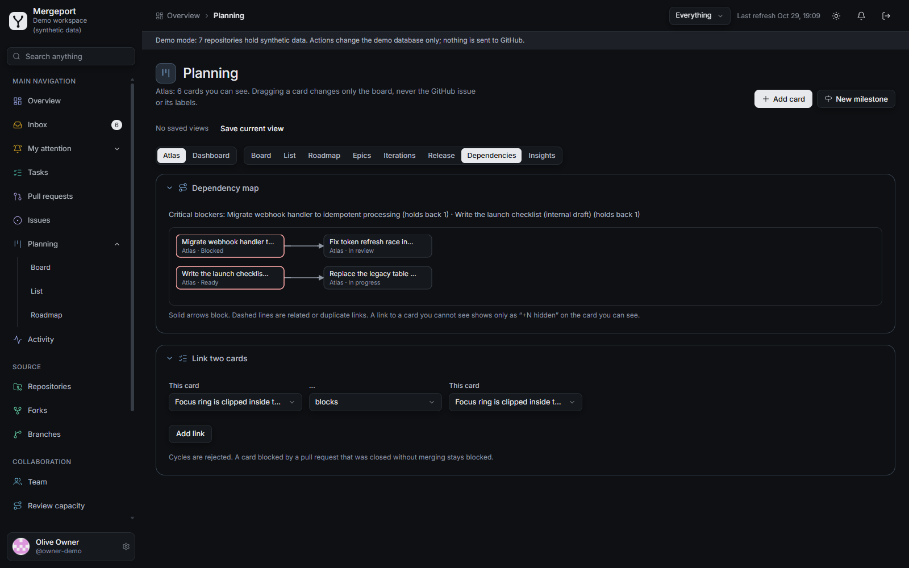
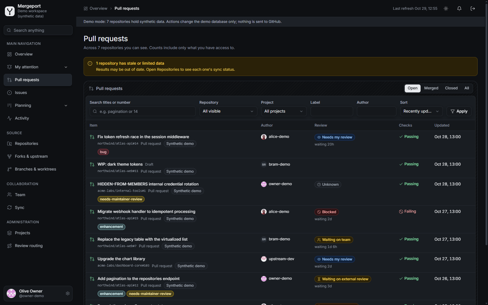
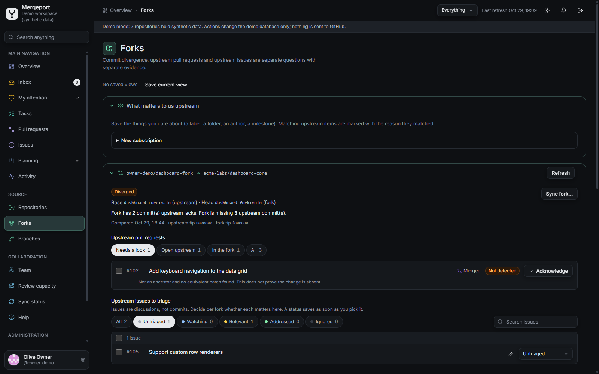
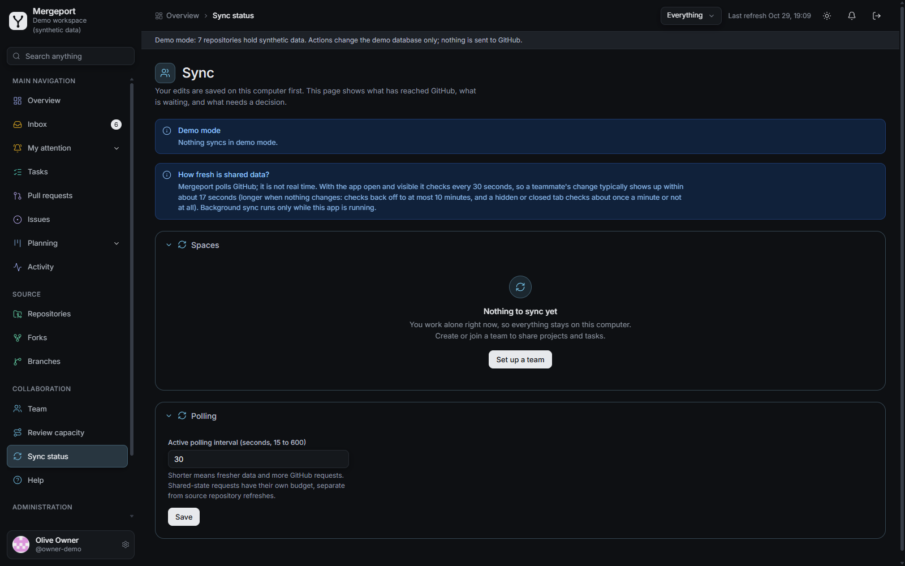
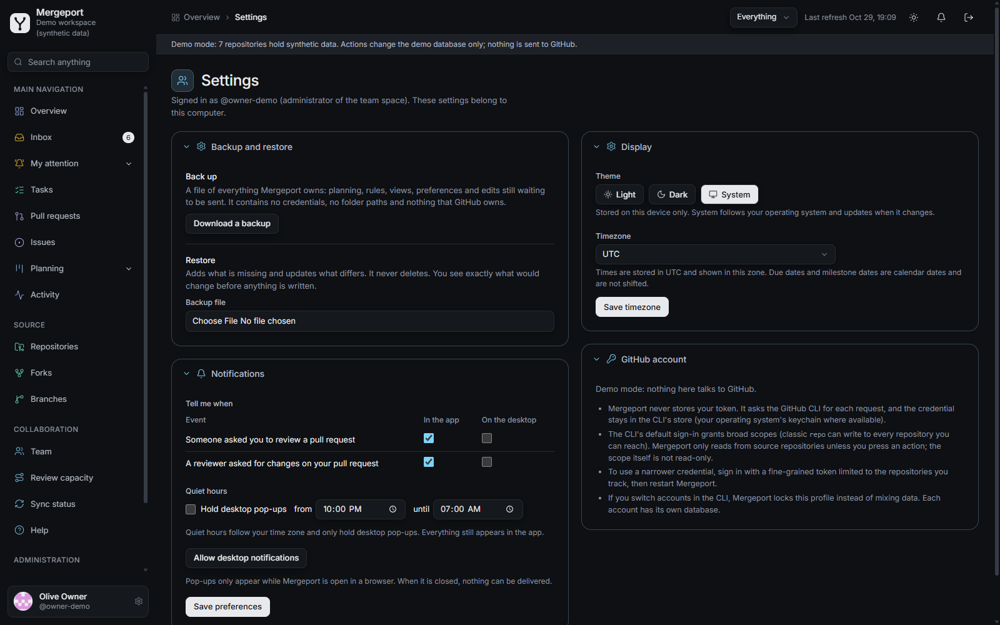
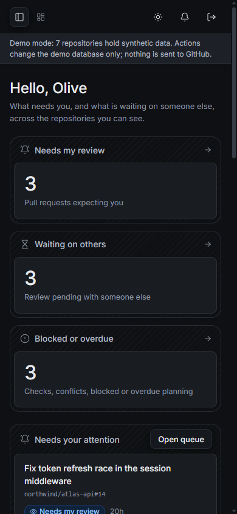

# Mergeport

A control center for selected GitHub repositories: review queues ("I should review" vs "waiting on someone else"), planning across repositories, fork and upstream tracking, and read-only visibility of local worktrees. It is a hosted, multi-tenant web app on PostgreSQL: workspaces, magic-link or OIDC sign-in, a GitHub App, federation between instances and an MCP endpoint for AI apps. Operating a deployment is in `docs/auth.md`, `docs/github-app.md` and `docs/tenancy.md`.

Visual character follows <https://kravio-dashboard.vercel.app/> (`DESIGN.md`), in light and dark. Product intent is in `PRODUCT.md`; the design of the system is in `docs/architecture.md`.

> Status: implemented and tested against a simulated GitHub, and exercised **read-only** against one real GitHub account (discovery, 56 tracked repositories, issues, pull requests, reviews, checks, forks, sync and recovery; see `docs/real-github-verification.md`). **Team collaboration has not been run with two real accounts** (`docs/team-test.md` is the prepared plan); no repository was created and no invitation was sent. See "What is verified" below.

## What it looks like

All screenshots use the built-in synthetic demo data (`npm run demo`): made-up people, repositories and pull requests, nothing from a real account.

| | |
| --- | --- |
|  **Overview**: what needs you, what waits on others, what is blocked. |  **Inbox**: pull requests waiting on you; done, snooze, and they return when something new happens. |
|  **My attention**: queues grouped by repository, the reason behind each behind "Why". |  **Ready to merge?**: evidence per row, who acts next, and CODEOWNERS routing beside the review state. |
|  **Planning board**: cross-repository cards; dragging never changes GitHub. |  **Named boards**: chosen columns, renamed labels and work-in-progress limits over the same cards. |
|  **Epics**: a shallow hierarchy with progress, owner and dates. |  **Dependencies**: blockers across projects, critical blockers, hidden ends stay anonymous. |
|  **Delivery analytics**: cycle time and aging work, only from recorded history. |  **Review in place**: diffs, inline comments, a pending review sent once, and changes since your last review. |
|  **Pull requests**: review state, checks and mergeability. |  **Review capacity**: who has how much waiting, and a configured backup suggestion. |
|  **Projects**: group repositories, required reviewers, sharing. |  **Review routing**: who must review, and who work waits on. |
|  **Repositories**: owner type, access, sync state. |  **Forks and upstream**: real commit divergence, relevance subscriptions, backports. |
|  **Sync status**: where each change is: saved here, queued, published, waiting for teammates. |  **Settings**: notifications, backup and restore, theme and GitHub account. |
|  **Light theme**: light, dark or system. |  **Phone layout.** |

## What you need

- **Node 24** (declared in `engines`: `>=24 <25`) and npm 10 or newer.
- **PostgreSQL.** `npm run db:dev` starts a native dev Postgres on port 5433 (no Docker); or point `DATABASE_URL` at your own.
- For a real deployment: a GitHub App, a public URL and a mail or OIDC sign-in. See `docs/auth.md`, `docs/github-app.md` and `docs/tenancy.md`.
- Optional, for the development sign-in without a hosted setup: the [GitHub CLI](https://cli.github.com/) (`gh`), signed in (`docs/github-cli-setup.md`). Mergeport never stores or logs your token and never sends it to the browser.

## Quick start

```bash
npm ci                          # install exactly what package-lock.json says; also generates the Prisma client (postinstall)
cp .env.example .env            # DATABASE_URL points at the dev Postgres below
npm run db:dev                  # separate terminal: native dev Postgres on 127.0.0.1:5433 (data in .data/pg)
npx prisma migrate deploy       # apply the schema (and again after every pull that adds migrations)
npm run demo                    # demo mode: synthetic data, no GitHub at all; opens on http://127.0.0.1:3000/sign-in
```

`npm run demo` applies pending migrations, seeds the synthetic demo workspace when the database has no users yet, and starts `next dev` on `127.0.0.1` with `DEMO_MODE=true` (it refuses a database that holds real repositories). Sign in from the demo people on `/sign-in`. Everything in the demo database is synthetic and labelled, and actions change that database only. The equivalent by hand: `DEMO_MODE=true npm run dev` after `npm run db:seed`.

For development with real GitHub data, run `npm run dev` without `DEMO_MODE` and sign in on `/sign-in` with your `gh` account (`docs/github-cli-setup.md`); the background job loop is a separate process, `npm run worker`. A hosted deployment sets `MERGEPORT_PUBLIC_URL` and the variables in `docs/auth.md` and `docs/github-app.md`, runs `npm start` for the web app and `npm run worker` for the jobs.

## Personal and Team

- **Personal** (default): everything stays on this computer. Repositories you track, boards, internal tasks, waiting notes, local worktrees.
- **Team**: you can additionally create or join a team. Mergeport-owned data (project configuration, board state, internal tasks, cross-repository milestones, routing, waiting annotations, triage decisions) is stored as small JSON files in **private GitHub repositories** and synced by every member's local copy. GitHub itself stays the source of truth for issues, pull requests, reviews and labels; each person fetches those with their own access and caches them locally.

Create, invite and join are in the app (**Team**). Creating a team shows the exact repository name, owner, visibility and permissions first and does nothing until you confirm. See `docs/architecture.md`.

### Reviewing code

Pull requests open on **Conversation**, **Files changed** and **Commits** tabs that switch instantly (the diff is fetched once, cached by commit, and warmed in the background). The diff looks like GitHub's: a file tree, unified or split layout, line numbers on both sides, Primer syntax colours in light and dark, expandable context between hunks, per-file **Viewed** marks that reset when the file changes again, each commit reviewable on its own, existing inline comments, and new inline comments posted to GitHub as you. **Repositories → Browse code** opens any tracked repository at any branch with a folder view, README, and highlighted files with line anchors. Code blocks in Markdown use the same colours.

### Upstream auto-update

Off by default, per fork (**Forks** page). When a mapped fork falls behind its upstream, Mergeport merges the newest upstream commit into its own `mergeport/upstream-sync` branch in a **private clone** (`<Mergeport home>/updater/<mapping>/`), optionally runs a check command you wrote (for example `npm test`) on this computer, and opens or updates **one pull request** into your fork branch. A conflicting or failing commit is skipped for the next older one (up to 6 back); a newer upstream commit restarts the attempt. It never touches your own working folders, never deletes a branch, never pushes to upstream, and pushes only the sync branch unless you choose the riskier `push` mode (a plain fast-forward of the fork branch, only after the check passed). Instead of merging, a fork can be set to **only warn about new upstream releases**: Mergeport then just reads the upstream's releases from GitHub (no clone, no git, no check command, nothing changed) and tells you when a new one is published; the first check only notes where things stand. Details and limits: `docs/architecture.md`, "Upstream auto-update".

### Tasks

**Tasks** is a GitLab-style work list on top of the planning cards: create a task, give it to someone by GitHub username, set status, priority, due date and labels, and discuss it in a comment thread with a history of who changed what. Filters: assigned to me, assigned by me, unassigned, all. Tasks assigned to you also show in **My attention**. In a team, tasks and comments sync like the rest of the shared data, so a task you assign appears on your teammate's computer.

### Daily digest

Each morning (after 08:00 by default, adjustable in **Settings**) Mergeport writes you a digest of the previous day: what you finished, what was left undone, what needs your attention and what is waiting on other people, with a link to each item. It is built only from the data already on your computer, with no AI, no network call and nothing sent to GitHub. If Mergeport was closed at that hour, the digest is made the next time it opens. Read it under **Daily digest** (older days included), on the Overview card, or from the bell. See `docs/architecture.md`.

### Joining an existing team

1. Accept the GitHub invitation (Team page, or from GitHub).
2. Open **Team**. Private `mergeport-*` repositories your account can read are listed with what they are and what joining downloads.
3. Review one and confirm. Projects, cards, review rules, waiting rules, fork mappings and the shared repository list then arrive on their own and stay in sync. Nothing is joined without that confirmation.

Repositories the team shares are matched to your own GitHub access; a repository you cannot read shows up as shared but unavailable to you.

### Workspaces

A hosted deployment holds many workspaces; the top bar has a workspace switcher for people who belong to more than one. See `docs/tenancy.md`.

## Commands

| Command | What it does |
| --- | --- |
| `npm run demo` | Demo mode on the dev Postgres: migrate, seed when empty, start the dev server |
| `npm run dev` | Next.js dev server on `127.0.0.1:3000` against `DATABASE_URL` |
| `npm run worker` | The background job loop (sync, digests, webhooks maintenance); several can share one database |
| `npm run db:dev` | Native dev Postgres on port 5433, data in `.data/pg` |
| `npm run build` / `npm start` | Production build (runs `prisma generate`) / apply migrations and serve it |
| `npm run typecheck` / `npm run lint` | `tsc --noEmit` / ESLint |
| `npm test` | Vitest. Tests use an embedded PostgreSQL on port 5434; no services needed |
| `npm run db:seed` | Seed synthetic data (`DEMO_MODE=true`) into the database named by `DATABASE_URL` |

## Agents

AI apps use the hosted MCP endpoint, `POST /api/mcp`, with a personal access token or OAuth: list projects, create, update and complete tasks, look up pull request status. Nothing it does changes GitHub. See `docs/mcp.md`. The old `npm run mp` command line and the stdio MCP server read a local profile database and were removed with the local launcher.

## Light, dark, system

Settings has **Light / Dark / System**, and the top bar has a quick toggle. The choice is stored on this device only (a first-party cookie, never synced to a team). The server renders it into the first byte of HTML, so there is no flash and no hydration mismatch. System follows the OS and updates live.

## Security model in brief

- **Account binding.** Every GitHub call runs as the account the profile was created for, identified by its immutable numeric user id, never as whichever account `gh` has selected at that moment. A switch with `gh auth switch` before, during or after a call cannot change who it runs as. If that account is not signed in, is a different id, or the CLI is too old, the call is **blocked** and you are asked to reconnect; nothing falls back to another account or an inherited `GH_TOKEN`.

- A guard (`src/proxy.ts`) refuses any `Host` that is not the public host (hosted) or a loopback name (development), and any state-changing request that is not same-origin.
- Pages need the session cookie. Other pages in your browser cannot use the app.
- GitHub calls are `gh api` with an argument array, never a shell string, each with a timeout and cancellation that kill the whole process tree. Credential headers are dropped. Tokens, keys, local paths, logs and worktree snapshots never enter a shared repository.
- **Joining is explicit.** Mergeport finds candidate coordination repositories and shows what each is; nothing is joined or imported until you press Join and confirm.
- **Pages never wait on GitHub.** Team and Connect render from the last saved result with its age; GitHub is asked in the background, and a failure keeps the saved list and says why (offline, rate limited, sign-in needed).
- Privacy is a real boundary: a restricted audience gets its **own private repository**. Data a person may not see is never written to a repository they can read, and is never merely hidden in the UI.
- Roles come from GitHub's permission on the team repository, not from a field in a file anyone can edit. A forged `role: "admin"` in a database row or a shared file grants nothing.
- A coordination repository is data. Mergeport never executes, installs or follows instructions from one.

## What is verified

See "Verification record" in `docs/architecture.md`. In short, automated: two isolated local clients (separate databases) against a simulated GitHub coordination service, covering live propagation, concurrent edits, same-record conflicts, duplicate retries, offline and reconnect, deletion, restart, schema mismatch, revoked access, rate-limit exhaustion, privacy of the common repository, forged roles, and mocked team creation, invitation and join flows; the scheduler recurrence regression; the `gh` transport; the loopback guard; the Postgres import. In a real browser (demo mode): light, dark and system, refresh persistence, mobile width, the sliding tab pill, board card movement and toasts.

**Not verified:** real two-account team collaboration (create, invite, join, revoke); real network loss (it was simulated at the `gh` boundary); SAML/SSO and organization-approval prompts; discovery of more than 100 repositories; operating-system reduced-motion setting, touch devices, and the Windows installer path for `gh`.
