# Mergeport

A control center for selected GitHub repositories: review queues ("I should review" vs "waiting on someone else"), planning across repositories, and fork and upstream tracking. It is a hosted, multi-tenant web app on PostgreSQL: workspaces, magic-link or OIDC sign-in, a GitHub App, federation between instances and an MCP endpoint for AI apps. Operating a deployment is in `docs/auth.md`, `docs/github-app.md` and `docs/tenancy.md`.

Visual character follows <https://kravio-dashboard.vercel.app/> (`DESIGN.md`), in light and dark. Product intent is in `PRODUCT.md`; the design of the system is in `docs/architecture.md`.

> Status: implemented and tested against a simulated GitHub and a fake GitHub App server (installation lifecycle, webhooks, user tokens). The hosted paths are covered by the automated suite; how the GitHub App is verified against real GitHub is in `docs/github-app.md`. Nothing here creates repositories or sends invitations on GitHub.

## What it looks like

All screenshots use the built-in synthetic demo data (`npm run demo`): made-up people, repositories and pull requests, nothing from a real account.

| | |
| --- | --- |
|  **Overview**: what needs you, what waits on others, what is blocked. | 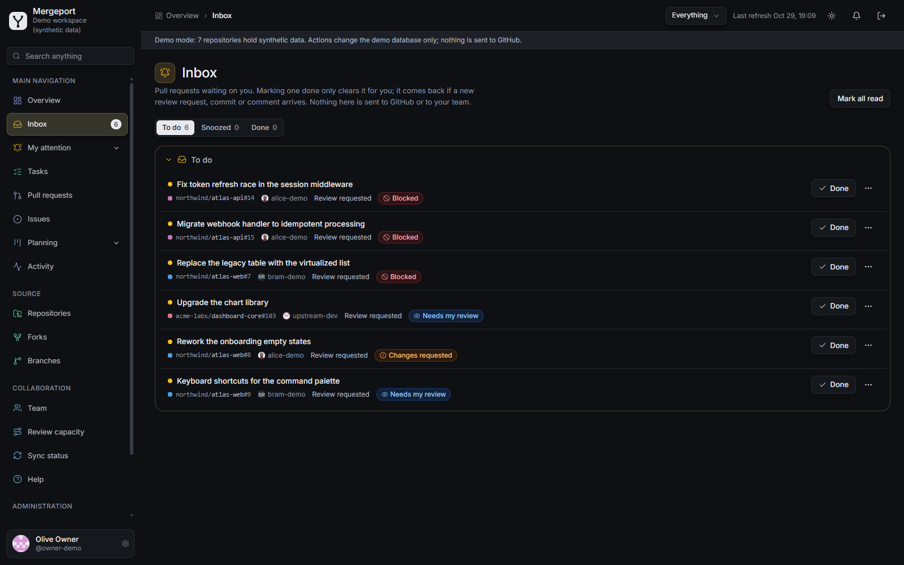 **Inbox**: pull requests waiting on you; done, snooze, and they return when something new happens. |
| 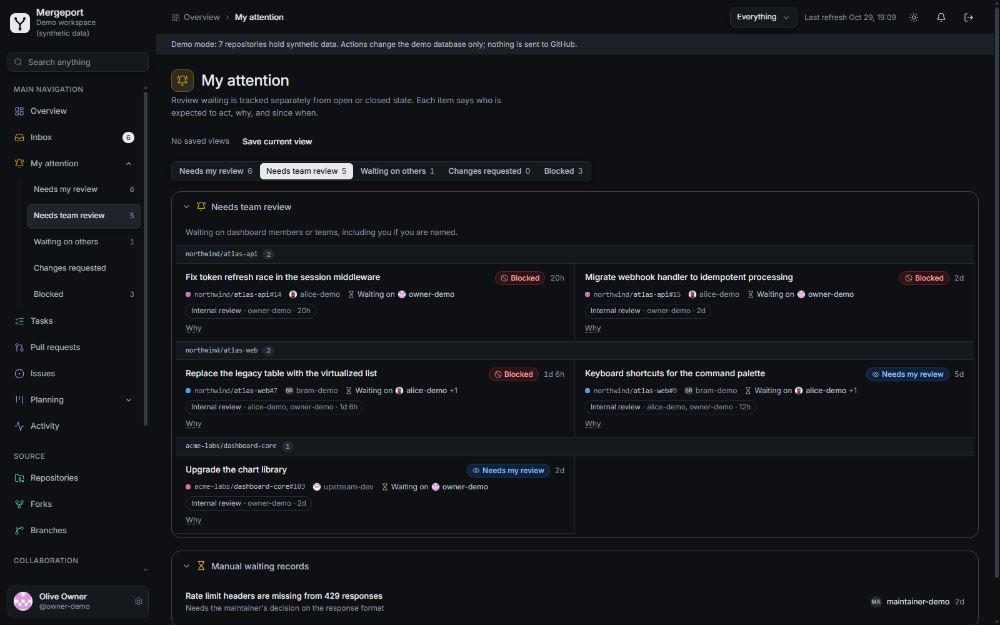 **My attention**: queues grouped by repository, the reason behind each behind "Why". | 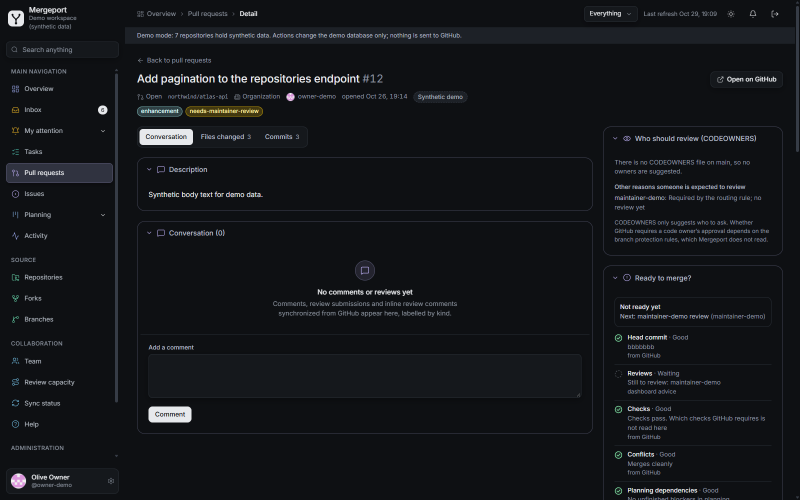 **Ready to merge?**: evidence per row, who acts next, and CODEOWNERS routing beside the review state. |
| 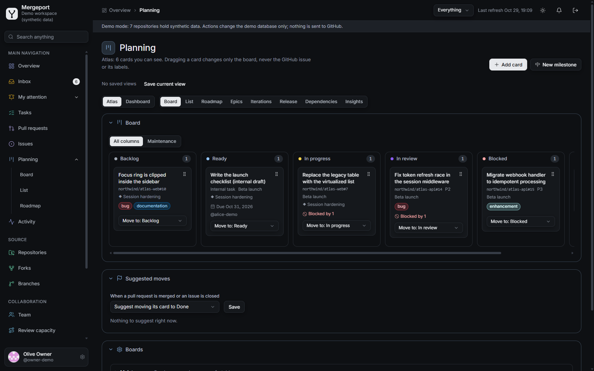 **Planning board**: cross-repository cards; dragging never changes GitHub. |  **Named boards**: chosen columns, renamed labels and work-in-progress limits over the same cards. |
| 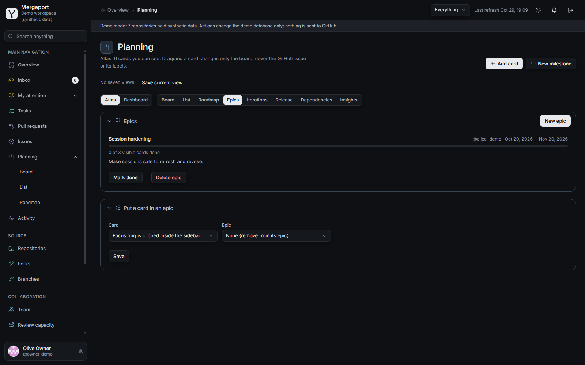 **Epics**: a shallow hierarchy with progress, owner and dates. |  **Dependencies**: blockers across projects, critical blockers, hidden ends stay anonymous. |
| 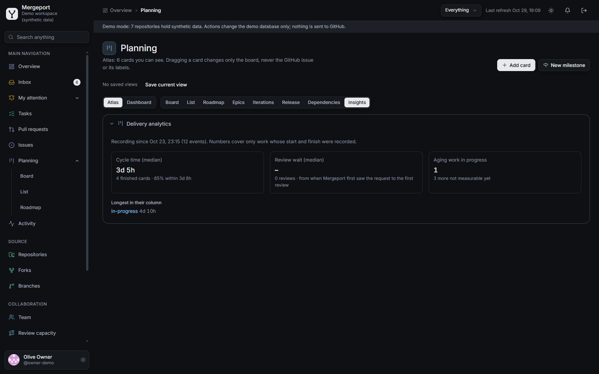 **Delivery analytics**: cycle time and aging work, only from recorded history. | 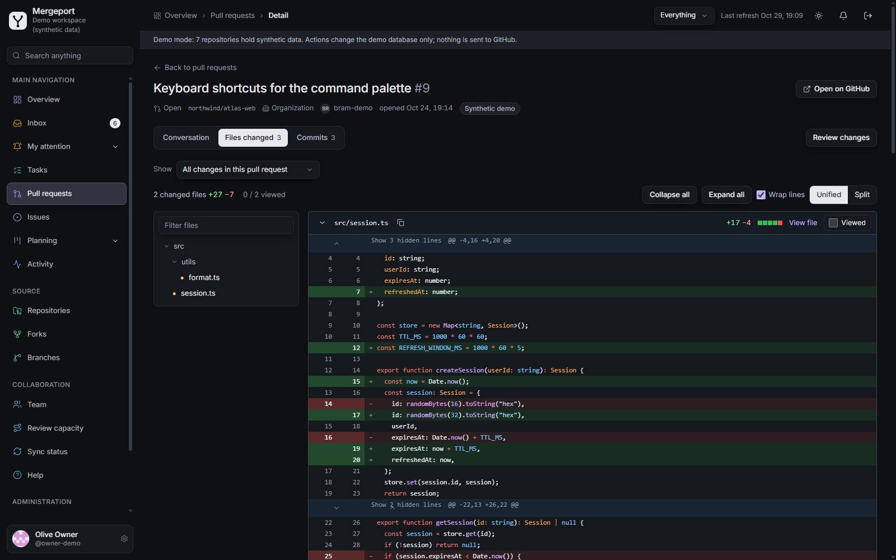 **Review in place**: diffs, inline comments, a pending review sent once, and changes since your last review. |
|  **Pull requests**: review state, checks and mergeability. | 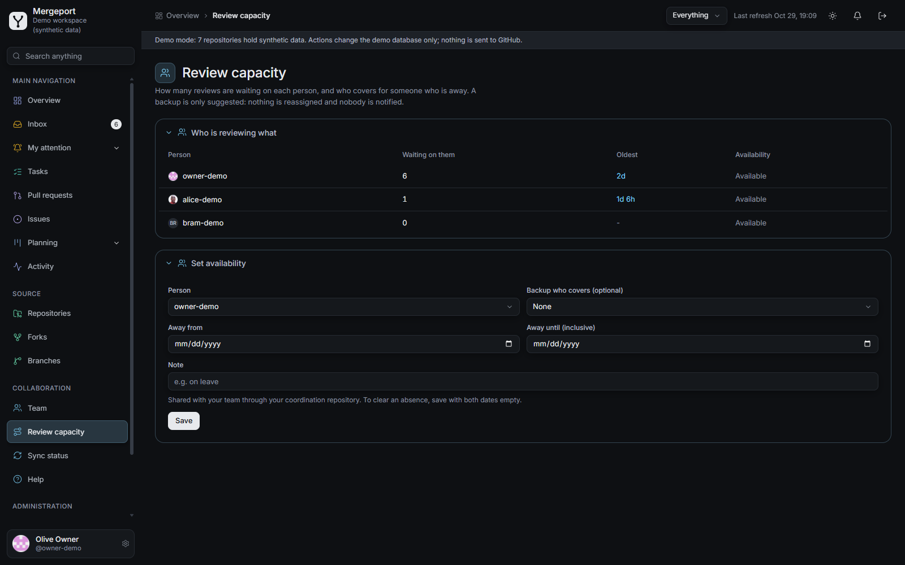 **Review capacity**: who has how much waiting, and a configured backup suggestion. |
| 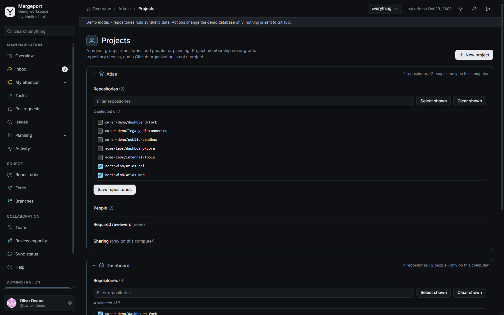 **Projects**: group repositories, required reviewers, access. | 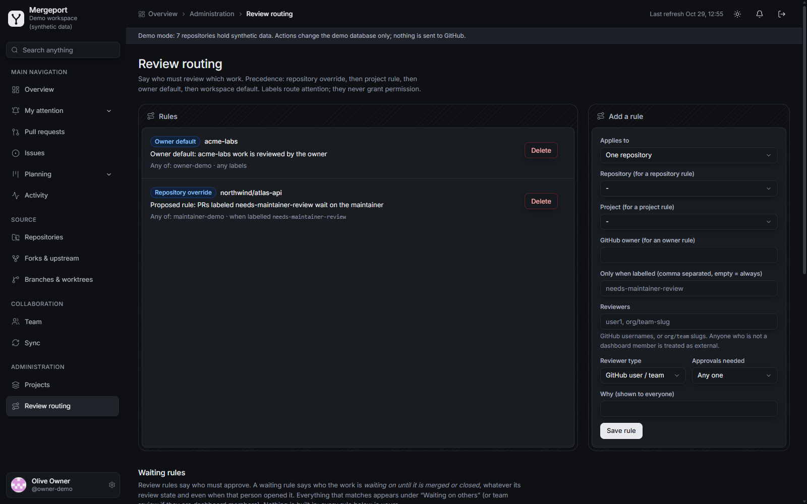 **Review routing**: who must review, and who work waits on. |
| 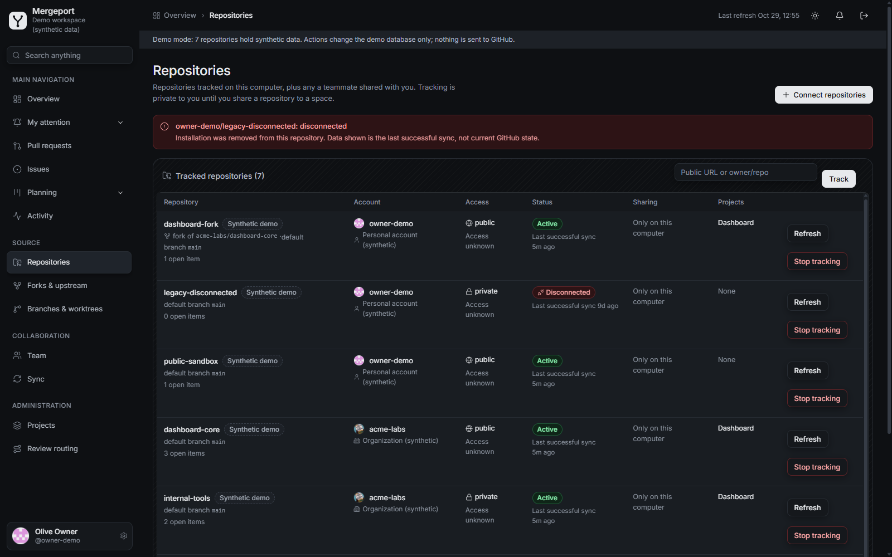 **Repositories**: owner type, access, sync state. |  **Forks and upstream**: real commit divergence, relevance subscriptions, backports. |
|  **Sync status**: when each tracked repository was last refreshed from GitHub, and what needs attention. |  **Settings**: notifications, backup and restore, theme and GitHub link. |
| 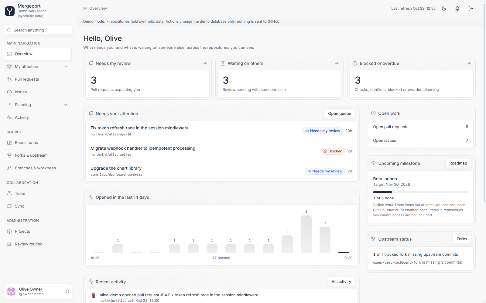 **Light theme**: light, dark or system. |  **Phone layout.** |

## What you need

- **Node 24** (declared in `engines`: `>=24 <25`) and npm 10 or newer.
- **PostgreSQL.** `npm run db:dev` starts a native dev Postgres on port 5433 (no Docker); or point `DATABASE_URL` at your own.
- For a real deployment: a GitHub App, a public URL and a mail or OIDC sign-in. See `docs/auth.md`, `docs/github-app.md` and `docs/tenancy.md`.

## Quick start

```bash
npm ci                          # install exactly what package-lock.json says; also generates the Prisma client (postinstall)
cp .env.example .env            # DATABASE_URL points at the dev Postgres below
npm run db:dev                  # separate terminal: native dev Postgres on 127.0.0.1:5433 (data in .data/pg)
npx prisma migrate deploy       # apply the schema (and again after every pull that adds migrations)
npm run demo                    # demo mode: synthetic data, no GitHub at all; opens on http://127.0.0.1:3000/sign-in
```

`npm run demo` applies pending migrations, seeds the synthetic demo workspace when the database has no users yet, and starts `next dev` on `127.0.0.1` with `DEMO_MODE=true` (it refuses a database that holds real repositories). Sign in from the demo people on `/sign-in`. Everything in the demo database is synthetic and labelled, and actions change that database only. The equivalent by hand: `DEMO_MODE=true npm run dev` after `npm run db:seed`.

Optional GitHub writes (create an issue from a task, comment), made as each person with their own linked GitHub account: `MERGEPORT_GITHUB_WRITES=on` (default `off`) lets a workspace owner or administrator switch them on in Settings, GitHub; the App then also needs Issues and Pull requests write permission, which each installation owner must accept (`docs/github-app.md`, "Writing to GitHub as you").

Real GitHub data needs a hosted setup: set `MERGEPORT_PUBLIC_URL` and the variables in `docs/auth.md` and `docs/github-app.md`, run `npm start` for the web app and `npm run worker` for the background jobs (sync, digests, webhook upkeep). There is no sign-in without it other than the demo's synthetic people.

### Reviewing code

Pull requests open on **Conversation**, **Files changed** and **Commits** tabs that switch instantly (the diff is fetched once, cached by commit, and warmed in the background). The diff looks like GitHub's: a file tree, unified or split layout, line numbers on both sides, Primer syntax colours in light and dark, expandable context between hunks, per-file **Viewed** marks that reset when the file changes again, each commit reviewable on its own, existing inline comments, and new inline comments posted to GitHub as you. **Repositories → Browse code** opens any tracked repository at any branch with a folder view, README, and highlighted files with line anchors. Code blocks in Markdown use the same colours.

### Tasks

**Tasks** is a GitLab-style work list on top of the planning cards: create a task, give it to someone by GitHub username, set status, priority, due date and labels, and discuss it in a comment thread with a history of who changed what. Filters: assigned to me, assigned by me, unassigned, all. Tasks assigned to you also show in **My attention**.

### Daily digest

Each morning (after 08:00 by default, adjustable in **Settings**) Mergeport writes you a digest of the previous day: what you finished, what was left undone, what needs your attention and what is waiting on other people, with a link to each item. It is built only from the data already stored in your workspace, with no AI, no network call and nothing sent to GitHub. If the worker was down at that hour, the digest is made when it is back. Read it under **Daily digest** (older days included), on the Overview card, or from the bell. See `docs/architecture.md`.

### Workspaces

A deployment holds many workspaces; the top bar has a workspace switcher for people who belong to more than one. See `docs/tenancy.md`. Who sees what inside a workspace (roles, access spaces, repository grants) is in `docs/roles.md`.

## Commands

| Command | What it does |
| --- | --- |
| `npm run demo` | Demo mode on the dev Postgres: migrate, seed when empty, start the dev server |
| `npm run dev` | Next.js dev server on `127.0.0.1:3000` against `DATABASE_URL` |
| `npm run worker` | The background job loop (sync, digests, webhooks maintenance); several can share one database |
| `npm run db:dev` | Native dev Postgres on port 5433, data in `.data/pg` |
| `npm run build` / `npm start` | Production build (runs `prisma generate`) / apply migrations and serve it |
| `npm run typecheck` / `npm run lint` | `tsc --noEmit` / ESLint |
| `npm test` | Vitest. Tests use an embedded PostgreSQL on port 5434; no services needed |
| `npm run db:seed` | Seed synthetic data (`DEMO_MODE=true`) into the database named by `DATABASE_URL` |

## Agents

AI apps use the hosted MCP endpoint, `POST /api/mcp`, with a personal access token or OAuth: list projects, create, update and complete tasks, look up pull request status. Nothing it does changes GitHub. See `docs/mcp.md`. The old `npm run mp` command line and the stdio MCP server read a local profile database and were removed with the local launcher.

## Light, dark, system

Settings has **Light / Dark / System**, and the top bar has a quick toggle. The choice is stored on this device only (a first-party cookie). The server renders it into the first byte of HTML, so there is no flash and no hydration mismatch. System follows the OS and updates live.

## Security model in brief

- A guard (`src/proxy.ts`) refuses any `Host` that is not the public host (hosted) or, for the demo run, a loopback name, and any state-changing request that is not same-origin.
- Pages need the session cookie. Other pages in your browser cannot use the app.
- Every query is scoped to one workspace (`docs/tenancy.md`); visibility inside it follows the viewer's role and GitHub access, evaluated per request.
- Mergeport holds no GitHub credential of its own. The GitHub App private key, webhook secret and encryption key are server configuration; a person's GitHub tokens are stored encrypted and never reach the browser, logs or exports.
- **Pages never wait on GitHub.** They render from stored data with its age; the worker and webhooks refresh it, and a failure keeps the saved data and says why.
- Roles live in the database and are changed only by an administrator. Nothing fetched from a repository is ever executed or installed.

## What is verified

See "Verification" in `docs/architecture.md`. In short: the automated suite (`npm test`, embedded PostgreSQL) covers tenancy and role scoping, the GitHub App flows against a fake GitHub, webhooks, the job queue and scheduler, sync idempotency, backup and restore, federation, MCP and OAuth, and the pages rendered per role; `tsc`, `eslint` and the production build are clean. In a real browser (demo mode): light, dark and system, refresh persistence, mobile width, board card movement and toasts.

**Not verified:** real-account GitHub App operation beyond what `docs/github-app.md` records; SAML/SSO and organization-approval prompts; the operating-system reduced-motion setting and touch devices.
